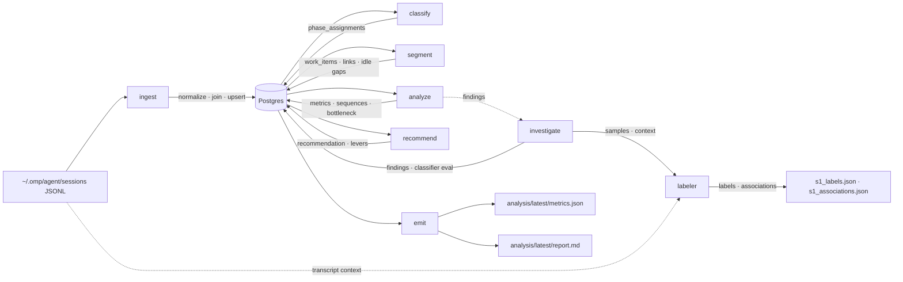

# TECHSPEC — sdl-flow-optimiser

Pipeline stages over a single local Postgres DB, analyzing omp session logs as
a queuing system. Companion to `docs/PRD.md`; the PRD's JTBD/constraints drive
every choice here.

## Architecture

### Layer diagram

### Physical architecture

- One machine: the laptop. One local Postgres instance (pgvector enabled),
  DB `sdl_flow_optimiser`. No other services; no auth beyond local trust
  (PRD constraint).
- The omp session store (`~/.omp/agent/sessions/`) is **read-only input**,
  never written by this system.
- Each stage is a separately runnable CLI target; an aggregate target runs
  the full pipeline. Both per-stage and aggregate targets exist (user
  decision).
- Artifacts (`analysis/latest/*`) are serialized views of the latest
  `AnalysisRun` — the DB is the source of truth; artifacts are for the omp
  chat loop (PRD scope item 6).
- **Labeler** — a local FastAPI web app (`make web`, port 8010, no auth):
  serves adjudicable samples (random / low-confidence / disagreements) with
  the surrounding transcript context from the store, records the user's
  agree/disagree + corrected phase + comment to `s1_labels.json`, and
  associates same-work sessions via `s1_associations.json`. JSON files are
  committed evidence (like the ground truth), not DB rows — adjudication
  precedes the DB stages. Static frontend, no build step, phone-usable.

### Data flow

1. `ingest` parses JSONL → normalized tables, resolving the 3-event tool
   execution join (`toolCall` → `tool_execution_start` → `toolResult`) via
   `toolCallId`. Incremental via `IngestManifest` (sha256 per file).
2. `classify` writes `PhaseAssignment` per event: rule-based first, embedding
   classifier as pluggable secondary (pgvector).
3. `segment` assembles `WorkItem`s from sessions + linkage; writes
   `WorkItemPhase` walks, `IdleGap`s with task-switch markup, `WorkItemLink`s.
4. `analyze` computes `Metric`, `PhaseSequence`, `Bottleneck` rows per
   `AnalysisRun`, per project × time bucket. **Only metrics whose source
   attribution S1 validated are computed** (PRD: nothing ships unvalidated).
5. `recommend` reasons over metrics → `Recommendation` + ranked
   `CandidateLever`s.
6. `investigate` runs the feasibility experiments (S1/S2/S3) as repeatable
   stages writing `Finding`s; findings gate step 4.
7. `emit` serializes the latest run to `metrics.json` + `report.md`,
   filtering below the confidence threshold.

## Technology choices

| Concern | Choice | Alternatives considered (and why they lost) |
|---|---|---|
| Language | Python 3.12 | — |
| ORM | SQLAlchemy 2.x | raw SQL: loses model↔class mapping the user required; hand-rolled migration pain |
| Store | Postgres 16 + pgvector | SQLite: no vector support, so the "semantic similarity search" PRD requirement (ambiguous research reads, plan→execute linkage) would force a later migration; DuckDB: analytic speed but no vector story, heavier dep |
| Schema migrations | Alembic | raw SQL migrations: no rollback/versioning discipline |
| Testing | pytest | — |
| Lint/format | ruff | — |
| Entry point | Makefile | one dev entry point per house scaffold convention |
| Embeddings | pgvector + a small local embedding model (e.g. sentence-transformers) | hosted APIs: PRD says nothing leaves the machine |

Rationale: PRD requirements "local durable store" + "semantic similarity
search" (which SQLite cannot serve without a later migration) + "boring
standard tooling (Makefile + Python + SQLAlchemy)" + "model objects
correspond to classes" → SQLAlchemy models are the contract between layers;
stages never hand-roll SQL.

## Spikes required to confirm

Locked by the PRD; each must prove its claim before dependent metrics ship.

- **S1 — Attribution feasibility.** Hand-label a sample (~3–5 sessions,
  mixed projects) per phase/project/PR; measure classifier precision/recall
  per phase (`ClassifierEval`). Proves: which metrics are trustworthy.
  Gates: every downstream metric.
- **S2 — PR attribution.** Probe `pr://` reads, PR-creation events, git
  metadata in logs. Proves: whether `WorkItem.kind='pr'` is consistently
  attributable, or session granularity stands.
- **S3 — Plan→execute linkage.** Prototype doc-reference linkage filtered to
  work-product docs (`docs/`, `local://` plans); measure false-link rate from
  skills/standards/config edits. Proves: whether logical work items can span
  sessions; embedding fallback if not.

## Strategic technical decisions

- **Model objects = implementation classes.** Every table in the model
  catalog maps 1:1 to a SQLAlchemy class (`Session`, `Event`,
  `ToolExecution`, `AssistantCall`, `UserMessage`, `Project`, `IngestRun`,
  `IngestManifest`, `PhaseDefinition`, `PhaseAssignment`, `ClassifierEval`,
  `WorkItem`, `WorkItemPhase`, `IdleGap`, `WorkItemLink`, `DocReference`,
  `PR`, `AnalysisRun`, `Metric`, `PhaseSequence`, `Bottleneck`,
  `Recommendation`, `CandidateLever`, `Finding`). Derived-layer tables are
  classes too, not schema sketches.
- **Labeler/findings objects are part of the model too.** The verification
  surface introduces its own domain objects, held in the `findings/`
  layer (evidence) and consumed by the labeler: `Transcript` (the session
  read as a conversation), `Run` (a same-phase stretch of tool calls — the
  unit the user adjudicates), `Label` (one adjudication), `Association` (a
  session pair that is one piece of work), `RunVerdict` (the user's phase
  for a run), and `Labels` (the append-only JSONL store of labels,
  associations, and run verdicts, with tombstones). These are part of the
  object model; a new one is a model change, not a free refactor.
- **All outputs live in the DB.** Metrics, recommendations, findings are
  persisted rows per `AnalysisRun` — the DB is the record of every pipeline
  decision (PRD: "DB is the record, not just normalized logs"). `emit` is a
  serializer, not a computation.
- **Stages are pure w.r.t. files.** Only `ingest` reads disk input; every
  other stage reads/writes the DB. Re-running `classify` after a classifier
  tweak never re-parses logs. This makes `AnalysisRun` rows comparable over
  time — the V2 dashboard is a query, not a new pipeline.
- **`AnalysisRun` is the spine.** One row per pipeline run; all metrics/
  recommendations/findings reference it. Time-series improvement tracking
  (V2) reads runs, never recomputes history.
- **Confidence gating is structural.** `investigate` findings mark which
  attributions are validated; `analyze` refuses unvalidated metrics; `emit`
  drops below-threshold rows. Confidence is a column, not a comment.
- **One shared DB for all projects.** Cross-project context-switching is a
  core JTBD; per-project DBs would make it unanswerable.
- **Recommend is a separate stage** (user decision): the queuing-theory
  reasoning is the product's brain; isolating it makes the challenge loop
  ("but what about this?") testable against `CandidateLever` rows.
- **Embeddings are lazy.** `user_messages.text` and
  `tool_executions.intent` are stored from day one; the embeddings table
  populates only when the pgvector classifiers/linkage are enabled.
- **Compactions excluded** (user decision): parsed for coverage, never
  analyzed.
- **Idle gaps stored raw, never interpreted**, except task-switch markup
  when a gap overlaps another session's activity (derivation, not storage).
